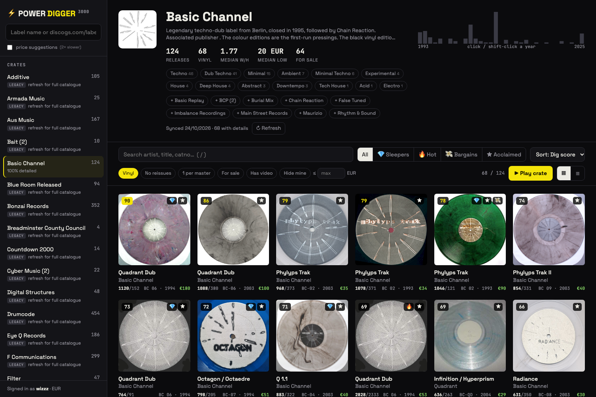

# ⚡ Power Digger 3000

Find the needles in a record label's haystack. Add a Discogs label and Power Digger ranks its whole catalogue by how *wanted*, how *scarce*, and how *loved* each record is. Then you can skim through the best ones with a built-in YouTube player and add keepers to your Discogs wantlist with one key.



## Quick start

```bash
cp .env.example .env            # put your token in: https://www.discogs.com/settings/developers
python3 -m venv .venv
.venv/bin/python -m pip install -e .
.venv/bin/python -m powerdigger  # opens http://127.0.0.1:8300
```

With [uv](https://docs.astral.sh/uv/) it's just `uv run python -m powerdigger`.

Old `Data/<Label>/raw_*.json` dumps from v1 are imported automatically on first start (or run `python -m powerdigger import-legacy`). Those labels show a **legacy** badge: hit ↻ to pull the full catalogue.

## How it works

Discogs allows 60 requests/minute, so the sync is built around that limit:

1. **Catalogue (seconds).** `/labels/{id}/releases` returns 100 releases per request *including* want/have counts, format, cover, and your own wantlist/collection flags. A 1,000-release label is fully browsable and ranked after about 10 requests.
2. **Details (background).** `/releases/{id}` adds rating, styles, lowest marketplace price, number for sale, tracklist and YouTube videos. It runs one request per release, **most promising first**, and the UI updates live. Price suggestions are optional because they cost a second request per release.

v1 needed three requests per release before you saw anything. A shared sliding-window rate limiter also reads `X-Discogs-Ratelimit-Remaining`, so parallel syncs and on-demand lookups never run into 429s.

Everything lives in a single SQLite file (`powerdigger.db`). Labels that share releases share rows.

## Scoring

All scores are percentiles **within the label** (vinyl and other formats are ranked separately):

| Signal | Formula | Weight |
|---|---|---|
| Scarcity | `(want + 2) / (have + 10)`, smoothed so 3 wants / 1 have doesn't beat a 900/150 classic | 50% |
| Demand | `log(1 + want)` | 25% |
| Quality | Bayesian rating, shrunk toward the label mean with 5 phantom votes | 25% |

Tags: **💎 sleeper** (top-20% scarcity, below-median haves), **🔥 hot** (top-10% wants), **💸 bargain** (cheap copy of a high-scoring record, or under 70% of the VG+ suggestion), **★ acclaimed** (≥ 4.5 from 10+ votes).

## Digging

- Filters: style chips, year histogram (click, shift-click for a range), vinyl only, no reissues, one per master, for sale, has video, hide what you own, max price, free-text search.
- **▶ Play crate** plays the first video of every record in the current sort order. Records that don't have details yet are fetched on the fly.

| Key | |
|---|---|
| `→` / `n` | next record |
| `←` / `p` | previous record |
| `↓` / `t` | next track on this record |
| `w` | toggle wantlist |
| `Enter` | open details |
| `Space` | play / pause |
| `/` | search |

## Config (`.env`)

| Var | Default | |
|---|---|---|
| `DISCOGS_TOKEN` | – | personal access token (required) |
| `PD_CURRENCY` | `EUR` | marketplace currency |
| `PD_DB` | `./powerdigger.db` | database location |
| `PD_DETAIL_MAX_AGE_DAYS` | `30` | re-fetch details older than this on refresh |

## Layout

```
powerdigger/
  discogs.py        async API client + rate limiter
  db.py             SQLite schema & queries
  sync.py           background catalogue/detail sync
  scoring.py        dig score + tags
  server.py         FastAPI JSON API
  legacy_import.py  v1 Data/ importer
  static/           frontend (vanilla JS, no build step)
legacy/             the original Streamlit app, for reference
```
